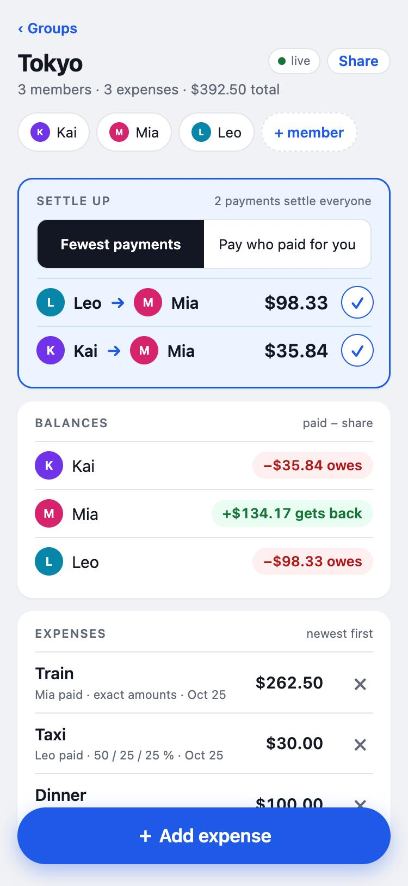
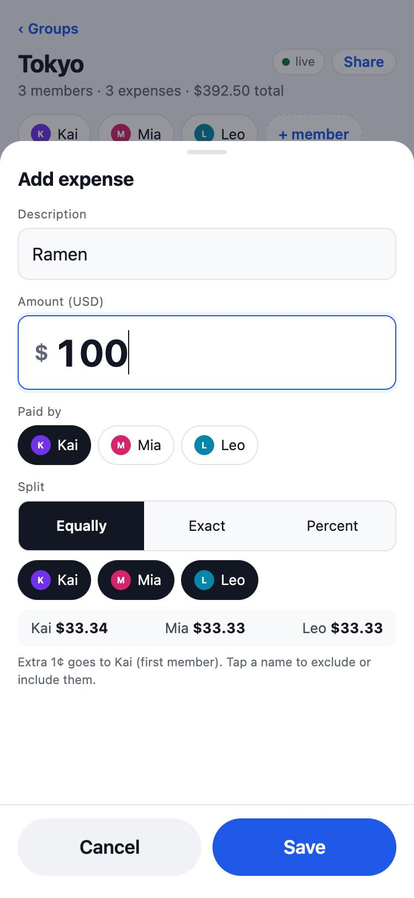

# Group Expense Splitter

A small full-stack app for friends splitting shared costs on a trip. Create a group, add members
by name, log expenses (paid by whom, how much, split equally / by exact amounts / by percentages),
and see each person's balance plus a settle-up plan. Expenses can be edited or deleted; data lives
in SQLite; two browsers on the same group see each other's changes live.

<p align="center">
  
  &nbsp;&nbsp;
  
</p>

## Run it

Requires Node ≥ 24 and pnpm (`corepack enable` gives you pnpm).

```bash
pnpm install
pnpm dev        # server on :3000, web on :5173 (proxies /api) → open http://localhost:5173
```

```bash
pnpm test       # 62 tests: money logic, rates, service layer on an in-memory DB
pnpm build      # web → web/dist, server → server/dist
pnpm start      # production: one process on :3000 serving the API and the built SPA
```

Environment: `PORT` (default 3000), `DB_PATH` (default `server/data/app.db`, created on first run).

To try the live-update behaviour, open the same group URL in a second browser. To try it from a
phone on the same Wi-Fi, Vite is bound to all interfaces: open `http://<your-LAN-IP>:5173` and
share the group link from there.

## Stack

| Layer    | Choice                                   | Why                                                                                              |
|----------|------------------------------------------|--------------------------------------------------------------------------------------------------|
| Server   | Node 24 · TypeScript · Hono              | Web-standard `Request`/`Response`, zero deps, typed route params, built-in SSE helper.           |
| Storage  | `node:sqlite` (built into Node ≥ 22)     | Real SQL with transactions and foreign keys, no native build step, one file to back up.          |
| Validate | zod                                      | Shape validation at the edge; money rules live in one pure module (below).                       |
| Web      | Vite · React 19                          | No router or state library — two routes and one data hook were enough.                           |
| Live     | Server-Sent Events                       | One-directional "something changed, refetch" is all the UI needs; simpler than WebSockets.       |

## Design decisions

**All money is integer minor units of the group's base currency.** Each currency has its own
`decimals` (USD 2, TWD/JPY/KRW/VND/IDR 0), so a minor unit is a cent for USD and a whole yen for
JPY. Amounts arrive as decimal strings (`"12.34"`), are parsed with string arithmetic against that
currency's decimals (TWD `"12.5"` is rejected), and never touch a float. The web app only formats
minor units for display.

**Splitting is one pure module — [`server/src/money.ts`](server/src/money.ts).** No DB, no HTTP,
fully unit-tested, and the only place that knows the rounding rules:

- *Equal*: `floor(total / n)` each; the remaining cents go one each to the first members in
  member order. `$100 / 3 → 33.34, 33.33, 33.33`.
- *Percent*: computed in integer basis points (`33.33% → 3333`), floor each share, then hand out
  the residual by largest remainder. Percents must sum to 100 ± 0.01 (so `33.33 × 3` is accepted);
  because of that tolerance the residual can be several cents or negative on large totals, and the
  distribution loops until shares sum to the total exactly. `$1000 at 33.33 × 3 → 333.34, 333.33, 333.33`.
- *Exact*: shares must sum to the total to the cent, else 400.
- *Settle up — fewest payments* (`settle`): creditors and debtors sorted by size, two-pointer
  greedy, each step clears the smaller side. At most n − 1 transfers. Not guaranteed globally
  minimal (that problem is NP-hard); it is the heuristic the well-known apps use. Because it nets
  debts across everyone, you can end up paying someone who never paid for you — the first real
  user of this app found that confusing (Tricount's FAQ has to explain the same thing), so there is
  also:
- *Settle up — pay who paid for you* (`settleDirect`): per expense, each non-payer owes the payer
  their share; the two directions of every pair are netted and one transfer is emitted. More
  transfers, larger total, but every transfer goes to someone who actually covered you. The API
  returns both plans; the settle card toggles between them (default: fewest). Both zero every balance.

**Balances are derived, never stored.** `balance = Σ paid − Σ share`, recomputed from
`expenses` + `expense_splits` on every read. Editing an expense replaces its row and its splits in
one transaction; deleting cascades. There is no stored total that can drift out of sync.

**Splits store both the result and the input.** `expense_splits.share_cents` is what the member
owes; `input_value` is what the user typed (`"33.33"` percent or `"87.50"` exact). The edit form
round-trips the original intent instead of showing rounded cents.

**Member order is insertion order (`rowid`), not a timestamp.** The remainder cent goes to "the
first member", so that order has to be deterministic; two members created in the same millisecond
would otherwise swap. (Found by a reviewer running the tests on a faster machine.)

**The API returns one view.** `GET /api/groups/:id` carries group, members, expenses with splits,
balances and the settlement plan. The frontend renders it and never computes money itself; the
per-person preview inside the expense sheet is display-only and the saved result comes from the server.

**Settling up is recorded as payments, not flags.** The settle-up plan is derived, so there is no
row to tick; "Mark paid" records a settlement `from → to, amount` that enters balances like an
expense paid by `from` whose only share is `to`. The plan is recomputed and the paid row disappears
or shrinks. Payments are listed and deletable, so a mis-tap is one more tap.

**Leaving is a flag, not a delete.** A member who leaves mid-trip keeps their history and may still
owe or be owed, so `members.left_at` is set instead of deleting the row. Left members drop out of
the default participants and default payer, move under a "Left" heading, stay in balances and in
the plan until they are at zero, and can rejoin. (Added after the first real group: a late joiner
kept being pre-selected into dinners they were not at.)

**Multi-currency: one base per group, a currency per expense.**

- *One base currency per group*, chosen at creation (default USD). Splits, balances, the settle
  plan and payments are all in base, so `money.ts` did not change beyond an optional `decimals`.
- *Each expense keeps what was paid and the rate it was converted at*: `currency`,
  `original_cents`, `rate_nanos`, and `amount_cents` in base. The rate is locked on the row
  rather than looked up on read — derived balances would otherwise drift every time the table
  changed, and users want to type the rate from their card statement anyway, so it is editable
  per expense.
- *Rates are integers scaled by 10^9* (base units per 1 unit of the foreign currency). Conversion
  is `orig × rate × 10^(baseDec − origDec) / 10^9` in BigInt, half-up to the base minor unit.
  10^6 was the first draft; KRW→USD is 0.00072, which keeps only three significant digits at that
  scale.
- *A seeded table, overridable per group.* [`server/src/rates.ts`](server/src/rates.ts) ships 20
  currencies with approximate USD rates; cross rates go through USD. Seeds are a starting point,
  not a feed. A group can set its own rate per currency (`group_rates`). A new expense resolves its
  rate as explicit `rate` > group override > seeded.
- *Exact shares are typed in the paid currency* and must sum to the original amount there. Each
  share is then converted at the expense's rate and the rounding residual is handed out by largest
  remainder, so Σ shares equals `amount_cents` exactly.
- *Settling stays in base.* The settle card's "show in" select converts the plan for display only
  (`≈` prefix); Mark paid still records the base amount.
- *The base is changeable only while the group has no expenses* (409 `GROUP_NOT_EMPTY`). After
  that, changing it would mean re-converting every expense and re-splitting its shares — the same
  history-rewrite problem as changing precision, so it is left for later (below).

**No accounts.** Knowing the group URL (a UUID v4) is the invite. Fine for a trip with friends;
a non-goal for this exercise.

## API

```
POST   /api/groups                    { name, currency? }     → 201 group · base default USD
PATCH  /api/groups/:id                { currency }            → 200 group · 409 GROUP_NOT_EMPTY
GET    /api/groups/:id                                         → view (see above)
PUT    /api/groups/:id/rates/:currency { rate }               → 200 rates block (override)
DELETE /api/groups/:id/rates/:currency                         → 204 (back to seeded)
POST   /api/groups/:id/members        { name }                → 201 member · 409 if name exists
POST   /api/groups/:id/expenses       ExpenseInput            → 201 expense
PUT    /api/groups/:id/expenses/:eid  ExpenseInput            → 200 expense
DELETE /api/groups/:id/expenses/:eid                           → 204
POST   /api/groups/:id/settlements    { fromId, toId, amount } → 201 settlement · 400 SAME_MEMBER
DELETE /api/groups/:id/settlements/:sid                        → 204
PATCH  /api/groups/:id/members/:mid   { left: boolean }        → 200 member
GET    /api/groups/:id/events         text/event-stream: `hello`, then `changed` after any write
```

```ts
ExpenseInput = {
  description: string;            // 1–200 chars
  amount: string;                 // in `currency`, at most its decimals; > 0
  currency?: string;              // as paid; default = group base
  rate?: string;                  // base per 1 unit, ≤ 9 decimals; default override, then seeded
                                  // (INVALID_RATE when currency = base)
  payerId: string;
  split:
    | { mode: "equal";   memberIds: string[] }
    | { mode: "exact";   shares: { memberId: string; amount:  string }[] }  // in `currency`
    | { mode: "percent"; shares: { memberId: string; percent: string }[] };
}
```

The view's expenses also carry `currency`, `originalCents` and the locked `rate`, and the view
has a `rates` block: `{ base, table }` with one row per other currency (`currency`, `name`,
`decimals`, `rate`, `source: "seed" | "override"`).

Errors are `400 { error, message | issues }` (`VALIDATION`, `PERCENT_SUM_MISMATCH`,
`EXACT_SUM_MISMATCH`, `UNKNOWN_MEMBER`, `DUPLICATE_MEMBER`, `UNKNOWN_CURRENCY`, `INVALID_RATE`, …),
`404`, `409` (`DUPLICATE_NAME`, `GROUP_NOT_EMPTY`).

## Frontend

Mobile-first, one page per group. The fastest path to log an expense is description → amount →
Save: payer defaults to the last one used and split defaults to everyone equally, with both
controls visible so the default is also a confirmation (an earlier collapsed "Kai paid · split
equally" summary row tested as too easy to miss). Balances use colour *and* sign (`+$12.34 gets back` / `−$12.34 owes` / `settled`), and the
settle-up card sits above balances because "who pays whom" is the question people open the app for.
The sheet previews each person's share and says where the odd cent goes.

No accounts, so the group URL is the invite: the header has a **Share** button (`navigator.share`
on phones, clipboard elsewhere) and a link back to `/`, which lists the groups this browser has
opened (localStorage — it does not follow you across devices; that is what sign-in would add).

Currencies: the create page picks the base. In the expense sheet a currency select sits beside
the amount (last used remembered per group), with a rate line — `1 JPY = 0.216129032 TWD · SEED`
— that can be edited inline or reset, and a `≈ NT$648` converted total; previews and shares are in
base. The base-currency badge in the header opens a **Converter** bottom sheet: amount + from/to,
a "1 TWD =" glance list, and the group's rate table with editable overrides. The settle card has a
display-only "show in …" select.

The design was researched before it was built — see [`docs/design/research.md`](docs/design/research.md)
for the conventions borrowed from Splitwise / Tricount / Settle Up and the ones deliberately dropped,
and [`docs/design/mockup.html`](docs/design/mockup.html) for the static mockup the UI follows.

## Project layout

```
server/src/money.ts        pure split / balance / settle logic (+ money.test.ts)
server/src/rates.ts        currency table, seeded cross rates, BigInt conversion (+ rates.test.ts)
server/src/db.ts           node:sqlite schema, WAL, foreign keys
server/src/service.ts      transactions, group checks, view assembly (+ service.test.ts)
server/src/routes.ts       Hono routes + zod validation + SSE
server/src/events.ts       per-group subscriber set
web/src/useGroup.ts        fetch + EventSource → refetch
web/src/recent.ts          recently opened groups (localStorage)
web/src/components/        Header · SettleCard · BalancesCard · ExpenseList · PaymentsList · ExpenseSheet · Converter
docs/SPEC.md               the spec the code was written against
docs/TODO.md               phase-by-phase log with what was verified and what was caught
docs/TODO-multi-currency.md the same log for the multi-currency round
```

## How it was built

Spec first, then four phases (scaffold → money logic → persistence/API → UI), each implemented in
its own AI-assisted session against the written spec and reviewed by a separate "lead" session
before moving on. That review loop caught two real bugs before the UI existed: the percent residual
under-distributing on large totals, and member order depending on a timestamp. A round of real use
afterwards added the IME fix (Enter during Chinese composition was adding members), the always-visible
payer/split controls, the "pay who paid for you" settlement mode, share link and recent groups,
"mark paid" settlements and members leaving.
All of it is recorded in [`docs/TODO.md`](docs/TODO.md) with the failing input or observation and
the spec change that followed. Multi-currency was added as a fifth round with its own phase log in
[`docs/TODO-multi-currency.md`](docs/TODO-multi-currency.md), again with a lead session reviewing
each phase built by an implementation session.

## What I'd do next

1. **Soft delete + audit log** instead of hard delete, so a group can see who changed what.
2. **Live rates.** Fetch current rates into the seeded table on demand; the schema does not
   change, since every expense already locks its own rate.
3. **Change the base currency after expenses exist** by re-converting history from
   `original_cents` and `rate_nanos` (and re-splitting exact shares from `input_value`).
4. **Optimistic UI** on save (today every write waits for the server and the SSE refetch).
5. **Rate limiting / shareable-link expiry** if this ever left a friends-only context.
6. **Remember participants per expense** — after someone leaves or a sub-group keeps eating
   together, pre-select the last used set instead of "everyone active".
